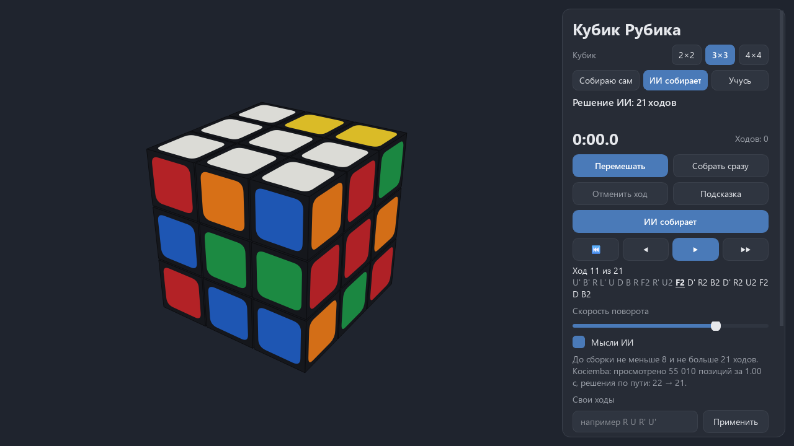
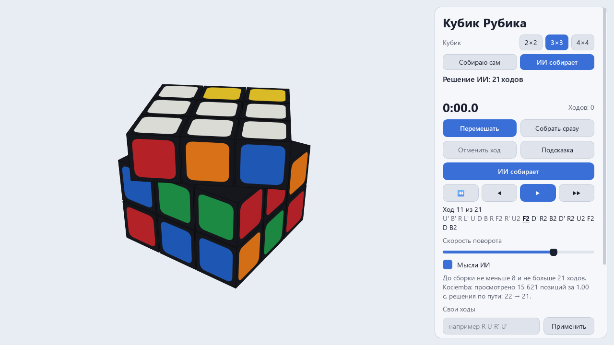
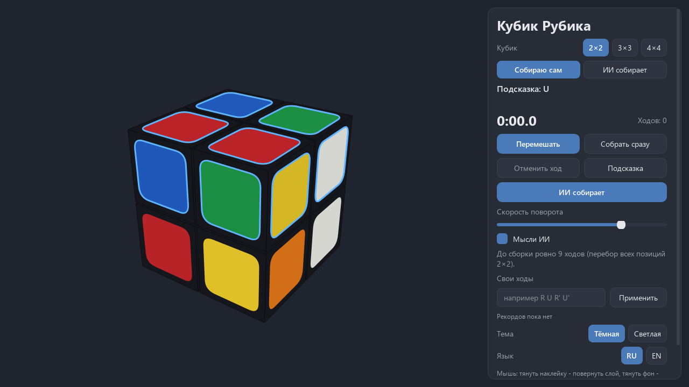
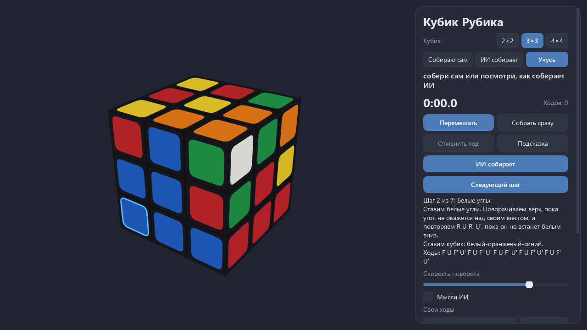
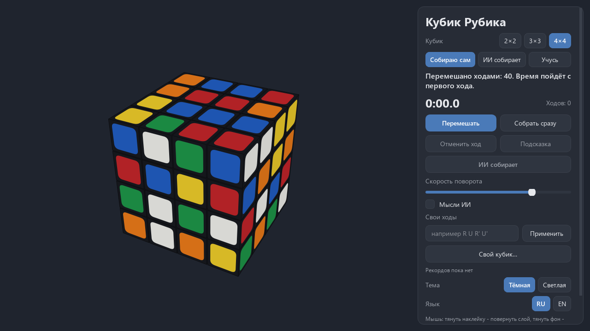

# Кубик Рубика и ИИ

**Объёмный кубик Рубика на Qt: собирай сам или отдай ИИ.**

[English version](README.md)



[](#) [](https://github.com/ALEXalesha/RubiksCubeAi/actions/workflows/ci.yml) [](LICENSE) [](https://www.python.org/) [](https://doc.qt.io/qtforpython-6/) [](https://claude.com/claude-code)

Код, тесты и документация этого проекта написаны Claude (Anthropic) в Claude Code. Идеи, проверка и решения - Алексей.

В работе (0.1.0). Python, PySide6 и numpy, без pygame.

## Что уже есть

- **Кубики 2×2, 3×3 и 4×4** в объёме на обычном QPainter: поворот слоя плавный, кубики сортируются по глубине.
- **Мышь:** тянуть наклейку - повернуть её слой, тянуть фон - вращать весь кубик. Курсор не захватывается.
- **Клавиши:** U D L R F B (с Shift - обратный ход), M E S, X Y Z; Ctrl+Z - отменить ход. Можно ввести запись, например `R U R' U'`.
- **«Собираю сам»:** перемешать, время с первого хода, отмена, подсказка с подсветкой нужного слоя, рекорды по размерам.
- **«ИИ собирает»:** ИИ ищет решение в отдельном потоке и показывает его по ходам: к началу, назад, пауза, вперёд, скорость.
- **«Учусь»:** послойный метод для начинающих в 7 шагов; ИИ поворачивает кубик белым вниз, объясняет каждый шаг словами и подсвечивает кубик, который ставится.
- **«Свой кубик»:** раскрасить наклейки на развёртке; программа проверит, что такой кубик бывает, и скажет, что не так.
- **«Мысли ИИ»:** сколько ходов осталось (не меньше и не больше), сколько позиций просмотрено, как решение укорачивалось во время поиска.
- **Невозможный кубик** объясняется: повёрнутый угол, перевёрнутое ребро, два переставленных кубика, неверные цвета.
- Тёмная и светлая темы, русский и английский, окно помнит своё место.

## ИИ

| Кубик | Как | Итог |
|---|---|---|
| 3×3 | Двухфазный алгоритм Kociemba: таблицы ходов и отсечения в numpy (строятся один раз, около 20 с, потом читаются из файла), поиск IDA* улучшает решение | 1000 случайных кубиков: все собраны, в среднем 20,81 хода (не больше 23), 1,37 с на кубик |
| 2×2 | Перебор в ширину всех 3 674 160 позиций | Оптимальные решения, в среднем 8,76 хода, не больше 11 |
| 2×2 | Сеть, которая научилась сама (идея DeepCubeA: итерация ценности, взвешенный A*), обучение 0,46 ч | 1000 случайных кубиков: все собраны, в среднем 8,95 хода, оптимально в 82,1% случаев, 0,04 с |
| 3×3 | Та же сеть, 1 час обучения (6000 шагов) | Перемешанные на 3-7 ходов: 100%; на 10: 93%; на 13: 30%; на 16 и больше: 0%. Случайные кубики: 0 из 1000 в пределах 5000 позиций. Пока намного слабее Kociemba; обучение продолжается |
| 3×3 | Послойный метод для начинающих правилами (режим «Учусь») | Любой кубик, около 160 ходов, каждый шаг объяснён, нужный кубик подсвечен |
| 4×4 | Решателя пока нет | Собираете сами |

Все цифры - в [game/models/passport.json](game/models/passport.json); тесты пересчитывают первые кубики с теми же зёрнами.

| | |
|---|---|
|  |  |
|  |  |

## Запуск

```
pip install -r requirements.txt
python main.py
```

Тесты: `pip install -r requirements-dev.txt`, затем `python -m pytest -q`. Мутационная проверка: `python tools/mutate.py`.

## Лицензия

MIT, см. [LICENSE](LICENSE).
